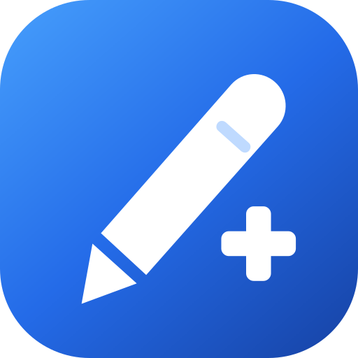

# 焦点笔 Plus · XiaomiSmartPenPlus



为小米灵感触控笔二代提供笔键重映射和按应用独立配置的 Android / LSPosed 模块，使用 [Compose Miuix](https://github.com/compose-miuix-ui/miuix) 界面。

**当前版本 1.2.1** · 包名 `xiaomismartpen.plus` · versionCode `6`

## 项目声明

这是社区独立维护的非官方项目，与小米及其关联公司无隶属、授权或背书关系。小米、Xiaomi、MIUI、HyperOS 和相关产品名称及商标归各自权利人所有，在此仅用于说明设备兼容性。图标为本项目原创的笔与加号图形，未使用小米官方标志。

**仅在小米 Pad 6 Pro、HyperOS 3/4 上测试通过。其他设备和系统版本尚未验证。**

软件按现状提供，不保证适用于所有笔、设备或 ROM。Root、LSPosed 和系统 Hook 可能影响系统输入行为；使用前请备份重要数据。遇到异常，可在 LSPosed 中停用模块并重启。完整责任与担保条款见 [Apache-2.0 许可证](LICENSE)。

本项目不提供或分发小米 ROM 提取的闭源组件。系统类仅在设备运行时通过反射调用。应用配置保存在设备本地；项目不包含遥测、广告或云同步。模块使用只读导出的 Provider 向系统进程提供设置快照，设备上其他应用也可能读取这些设置，因此请勿在设置中存放秘密信息。

## 功能

- 真实 Miuix 界面，支持深色模式和横屏双栏。
- 默认配置：没有专属配置的前台应用使用这组设置。
- 应用配置：独立保存两个笔键的接管开关、单击 / 长按 / 双击动作，以及时间阈值。首次添加复制当前默认配置，之后互不影响。
- 复制与删除：可复制默认配置给应用；删除专属配置后重新使用默认配置。恢复默认配置初始值会保留其他应用配置。

支持音量、媒体播放、返回、桌面、最近任务、翻页、滑动、区域截屏、透传与启动应用。1.2.1 新增笔键「左滑」「右滑」合成触摸动作：在屏幕中部做一次水平滑动，适配小说、阅读类应用的左右翻页——左滑为下一页，右滑为上一页。关闭接管，或将该笔键的三个动作均设为“不执行”，会保留原生行为。

每个手势使用按下时前台应用的配置，切换焦点会取消延迟动作。保存设置会立即通知后台更新；开机早期服务不可用时每 2 秒重试，正常每 5 秒后台刷新，输入线程不执行配置 IPC。

## 安装

1. 在 Root 设备安装兼容的 LSPosed。仅在小米 Pad 6 Pro、HyperOS 3/4 上测试通过；其他设备和系统版本尚未验证。
2. 从本仓库 Releases 下载 APK 并安装，打开“焦点笔 Plus”设置。
3. 在 LSPosed 启用本模块，勾选“系统框架”（`android` / `system_server`），然后重启。

## 构建

需要 JDK 17 或更高、Android SDK Platform 37.0（SDK Manager 包名 `platforms;android-37.0`）、Build Tools 37.0.0。构建使用 Gradle 9.6.0、AGP 9.2.1、Kotlin 2.4.20、Miuix 0.9.4。云端 SDK 工具使用 JDK 21。

用 Android Studio 打开项目，或设置 `ANDROID_HOME`；也可在未提交的 `local.properties` 设置 `sdk.dir`。首次构建需要联网下载依赖。

```bash
# Linux / macOS
bash gradlew :app:assembleDebug :app:lintDebug

# Windows PowerShell
.\gradlew.bat :app:assembleDebug :app:lintDebug
```

调试 APK：`app/build/outputs/apk/debug/app-debug.apk`。GitHub Actions 会构建并上传调试 APK，使用调试证书，与 Releases 正式签名不同。

正式构建使用 `:app:assembleRelease`。未提供签名配置时生成未签名 APK；签名时在本机或 CI 的秘密环境变量中提供以下四项：

| 环境变量 | 内容 |
| --- | --- |
| `SMARTPEN_KEYSTORE` | 私有密钥库的文件路径 |
| `SMARTPEN_STORE_PASSWORD` | 密钥库密码 |
| `SMARTPEN_KEY_ALIAS` | 密钥别名 |
| `SMARTPEN_KEY_PASSWORD` | 密钥密码 |

密钥库和密码不随源码分发。后续覆盖安装必须使用同一签名；自行签名的构建无法直接覆盖 Releases 安装。源码不包含本机 SDK 路径、设备配置、日志或签名私钥。

## 验证

JVM 回归直接编译生产配置存储、配置解析与输入控制代码，使用确定性时钟和 Android / Xposed 替身验证应用隔离、序列化、删除回退、焦点取消、注入过滤及后台监听，共 **148 条断言**。无需 Android 设备：

```bash
python backend-tests/run_tests.py
```

如 JDK 不在 PATH，可追加 `--java-home "JDK根目录"`。GitHub Actions 的后端回归、调试构建和 Android Lint 已通过。

**仅在小米 Pad 6 Pro、HyperOS 3/4 上测试通过。** 已验证 Miuix 界面、配置保存、1.2.0 正式签名 APK 安装，以及启用系统框架作用域并重启后的笔键控制器加载。

通过 ADB 向真实触控笔的 Linux 输入设备注入事件，完成 **19 项设备检查**（16 项输入与配置、3 项界面更新）：以音量动作验证两个笔键的单击 / 长按 / 双击均准确执行一次，应用专属动作与长按阈值独立生效，切换应用使用默认配置，删除专属配置后回退默认，切换焦点取消待执行动作。Miuix 界面保存设置立即生效，关闭接管后保留系统原生按键处理路径。测试后已完整恢复原有配置和媒体音量。其他设备和系统版本尚未验证。

## 开源许可

项目源码以 **Apache-2.0** 开源，详见 [LICENSE](LICENSE) 和 [NOTICE](NOTICE)。本版本包含 Miuix 界面、按应用配置、左滑 \/ 右滑翻页手势和原创笔与加号图标。

第三方组件保留各自版权与许可证，包括 Miuix、AndroidX / Compose、Kotlin、MaterialKolor、material-color-utilities 和 Xposed API。Xposed API 仅用于编译，由框架在运行时提供。许可文本和来源见 [第三方目录](app/src/main/assets/third_party)，并随 APK 打包。

图标 SVG 与 PNG 源见 [docs/assets](docs/assets)，重生成脚本见 `tools/render_icon.cjs`（需要 Node.js 与 `sharp`）。欢迎通过 Issues 提供设备、ROM、复现步骤；请先移除配置中的私人信息。
